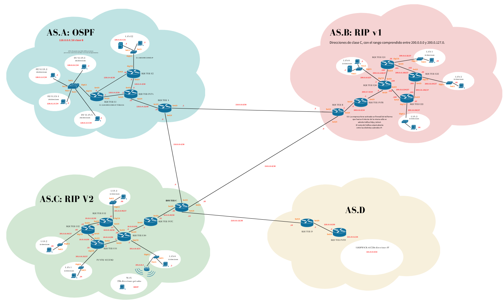
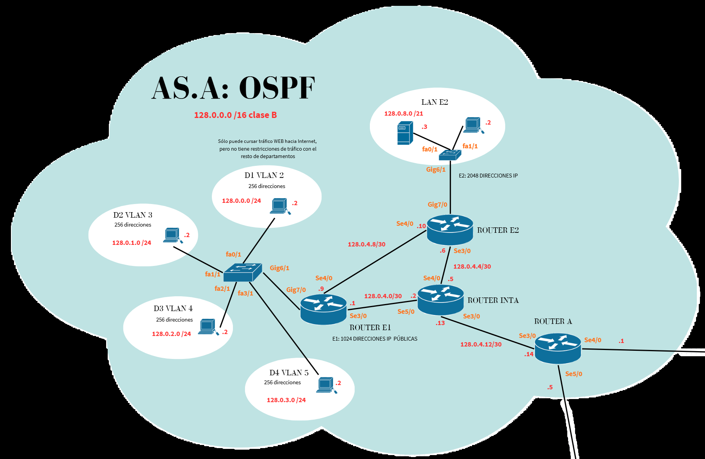
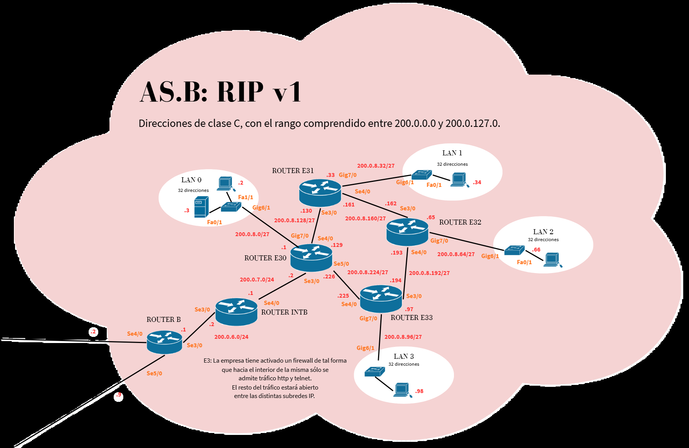
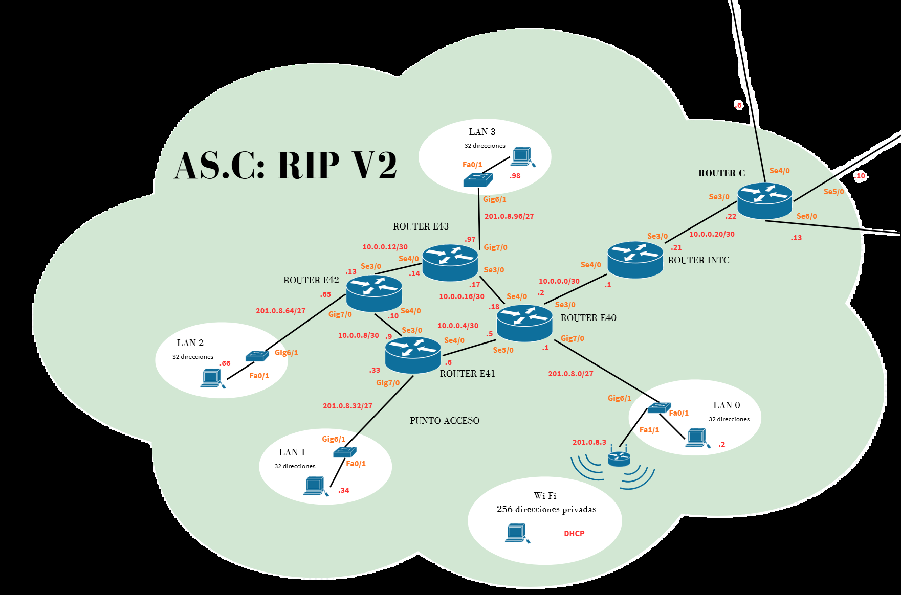
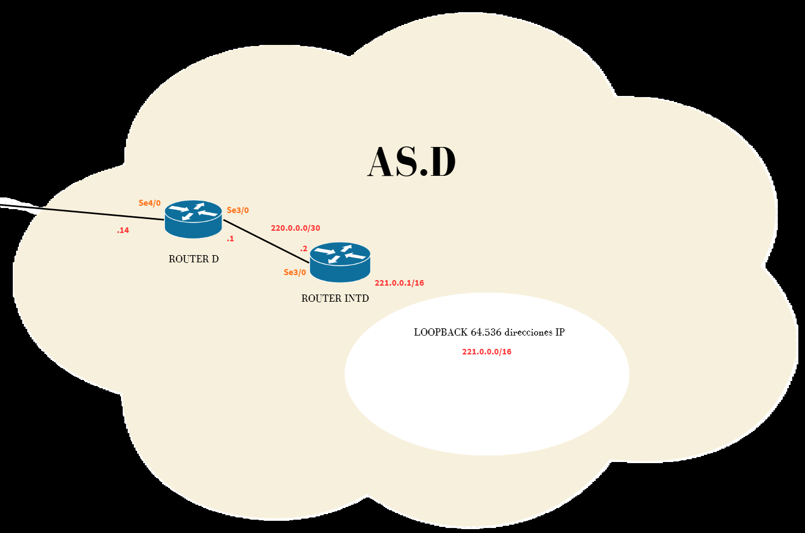

<h1 align="center">Arquitectura de Redes</h1>

<p align="center">
  <strong>Interconexión de cuatro sistemas autónomos mediante BGP</strong><br>
  OSPF · RIPv1 · RIPv2 · VLAN · ACL · Wi-Fi
</p>

<p align="center">
  Isabel Alonso Casas<br>
  Universidad Pontificia Comillas · ICAI<br>
  Práctica final de Arquitectura de Redes · Abril de 2026
</p>

<p align="center">
  <a href="memoria-redes.pdf"><strong>Leer la memoria completa (PDF)</strong></a>
  ·
  <a href="practica_definitiva.pkt"><strong>Archivo de Cisco Packet Tracer</strong></a>
</p>

## Descripción

Proyecto académico de diseño, configuración y documentación de una infraestructura formada por **cuatro sistemas autónomos (AS)**. Cada dominio utiliza un protocolo de encaminamiento interno diferente y se conecta con los demás mediante **BGP externo (eBGP)**.

La práctica integra planificación del direccionamiento IPv4, segmentación mediante VLAN, encaminamiento entre redes, agregación de rutas, conectividad inalámbrica y filtrado de tráfico mediante listas de control de acceso.

## Topología general



*Diagrama original incluido en la memoria del proyecto.*

Las vecindades entre sistemas autónomos son **A–B, A–C, B–C y C–D**. El AS C actúa como punto de tránsito para alcanzar el AS D desde A y B.

## Sistemas autónomos

| Sistema | Encaminamiento interno | Elementos principales |
| --- | --- | --- |
| **AS A** | OSPF, área 0 | Cuatro VLAN departamentales, Router-on-a-Stick, enlaces internos y ACL para limitar la salida del Departamento 1 a servicios web. |
| **AS B** | RIPv1 | Red empresarial con routers en anillo, subredes de tamaño uniforme y filtrado de entrada que permite HTTP y Telnet. |
| **AS C** | RIPv2 | LAN públicas, enlaces internos privados, red Wi-Fi con DHCP y desactivación de la sumarización automática. |
| **AS D** | Rutas estáticas | Router frontera, router interno y una interfaz loopback que representa la red `221.0.0.0/16`. |

### Direccionamiento y segmentación

Los bloques agregados principales documentados para los AS son:

| Sistema | Bloque principal |
| --- | --- |
| AS A | `128.0.0.0/16` |
| AS B | `200.0.0.0/17` |
| AS C | `201.0.0.0/17` |
| AS D | `221.0.0.0/16` |

En el AS A, las VLAN 2, 3, 4 y 5 corresponden a los cuatro departamentos y utilizan respectivamente `128.0.0.0/24`, `128.0.1.0/24`, `128.0.2.0/24` y `128.0.3.0/24`. El encaminamiento entre ellas se realiza mediante subinterfaces con encapsulación **802.1Q**.

El AS C utiliza direccionamiento privado `10.0.0.0` en los enlaces internos y `192.168.0.0/24` para la red inalámbrica. Las tablas completas de redes, máscaras, interfaces y gateways se encuentran en la memoria.

### Políticas de filtrado

- **AS A:** el Departamento 1 mantiene comunicación con los demás departamentos y tiene restringida la salida al exterior a HTTP y HTTPS.
- **AS B:** se permite la entrada desde el exterior a los servicios HTTP y Telnet de la empresa; el resto del tráfico entrante se bloquea mediante ACL.

Estas políticas forman parte de los requisitos del ejercicio. Un `ping` bloqueado por una ACL no implica por sí solo un fallo de encaminamiento.

## Tecnologías y competencias

- **Cisco Packet Tracer** y configuración de dispositivos mediante **Cisco IOS**.
- **eBGP** para la interconexión entre sistemas autónomos.
- **OSPF, RIPv1, RIPv2 y rutas estáticas** para el encaminamiento interno.
- **IPv4, subnetting, VLSM y CIDR** para planificar el direccionamiento.
- **VLAN, enlaces troncales 802.1Q y Router-on-a-Stick**.
- **ACL extendidas** para filtrar por origen, destino, protocolo y puerto.
- **Wi-Fi y DHCP**, junto con servicios HTTP y Telnet para las pruebas del laboratorio.
- Diagnóstico mediante tablas de rutas, comprobación de vecinos y pruebas de conectividad.

## Archivos del repositorio

| Archivo o carpeta | Contenido |
| --- | --- |
| [`practica_definitiva.pkt`](practica_definitiva.pkt) | Archivo de trabajo de Cisco Packet Tracer. |
| [`memoria-redes.pdf`](memoria-redes.pdf) | Memoria original de 52 páginas: requisitos, diseño, direccionamiento, implementación, verificaciones y configuraciones de los dispositivos. |
| [`docs/`](docs/) | Diagramas de la topología general y de cada AS, extraídos de la memoria. |

## Cómo abrir la práctica

### Requisito

Tener **Cisco Packet Tracer** instalado.

### Pasos

1. Descarga el repositorio desde **Code → Download ZIP** y descomprímelo.
2. Abre Cisco Packet Tracer.
3. Selecciona **File → Open** y abre **`practica_definitiva.pkt`**.
4. Deja que los protocolos de encaminamiento converjan antes de realizar las pruebas.
5. Consulta la memoria para revisar el direccionamiento, las configuraciones y las restricciones esperadas.

El archivo `.pkt` se abre con Packet Tracer; la simulación no se ejecuta en la página de GitHub.

## Verificaciones documentadas

La memoria describe pruebas de conectividad interna, comunicación entre AS, acceso a la loopback del AS D y comprobaciones de las restricciones de tráfico de los AS A y B.

Desde la pestaña **CLI** de los routers se pueden consultar, según el dispositivo, los siguientes comandos:

```text
show ip interface brief
show ip route
show ip protocols
show ip bgp summary
show access-lists
```

| Comprobación | Qué revisar |
| --- | --- |
| Interfaces | Direcciones IP, máscaras y estado de los enlaces. |
| Encaminamiento interno | Aprendizaje de rutas mediante el protocolo correspondiente a cada AS. |
| eBGP | Vecinos activos y prefijos recibidos entre routers frontera. |
| Conectividad | Pruebas `ping`, HTTP y Telnet en los casos permitidos por las ACL. |
| Filtrado | Accesos autorizados y bloqueos previstos en los AS A y B. |

Las configuraciones por dispositivo y los comandos utilizados durante la implementación están recogidos en el **anexo de la memoria**.

## Diagramas por sistema autónomo

<details>
<summary>AS A · OSPF y VLAN</summary>



</details>

<details>
<summary>AS B · RIPv1 y filtrado</summary>



</details>

<details>
<summary>AS C · RIPv2 y Wi-Fi</summary>



</details>

<details>
<summary>AS D · Rutas estáticas y loopback</summary>



</details>

## Autoría

**Isabel Alonso Casas** · Universidad Pontificia Comillas, ICAI.

Práctica final de Arquitectura de Redes, presentada el **24 de abril de 2026**.
